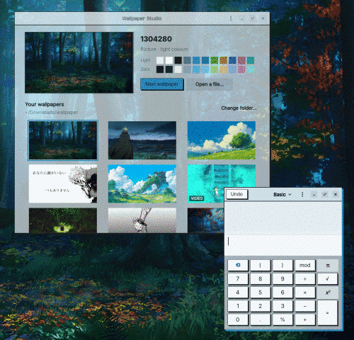
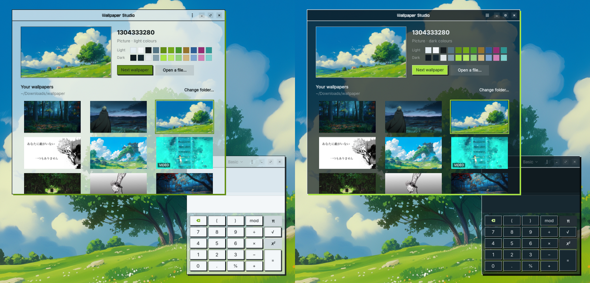
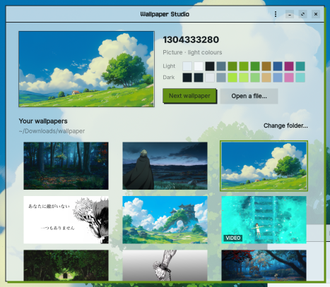

# Wallpaper Studio

Pick a wallpaper and your whole desktop takes its colours.



*Picking a wallpaper recolours the desktop and every open app on the spot. [Full-quality video](docs/demo.webm).*

- **Wallpapers:** pictures or looping videos, chosen from a folder of yours, with an optional new one every few hours.
- **Colours:** apps, GNOME Terminal and the lock screen are recoloured to match, in light, dark, or auto (light by day, dark at night).
- **One click back:** *Restore original look* puts every setting back the way it was.

Made for the 42 iMacs (Ubuntu 22.04, GNOME, X11), where the normal desktop picture setting is locked.
No sudo needed.



*One wallpaper, two looks: light by day, dark at night (or pick one).*

## Install

```sh
git clone https://github.com/yuxev/wallpaper-studio.git
cd wallpaper-studio
./install.sh
```

Then open **Wallpaper Studio** from your apps (press Super and type *wallpaper*).

## How to use it



1. **Pick a folder.** The app comes with a few wallpapers (including a looping video) to start with;
   *Change folder…* points it at your own pictures and videos instead.
2. **Click a wallpaper.** The desktop changes and every open app takes its colours within a second.
   You can also drop a picture onto the window, or use *Open a file…*.
3. **Choose light, dark or auto** under *Colours*. Auto is light from 07:00 and dark from 19:00.
4. **Optional:** a new random wallpaper every few hours, see-through windows, the wallpaper on your
   lock screen, and *Keep screen awake* while you read or watch something.

To undo everything, open the menu (⋮) and choose *Restore original look*.

## Your own style

Write your own style in `~/.config/gtk-3.0/gtk.css` and `gtk-4.0/gtk.css`. Wallpaper Studio only adds one
line at the top of the GTK 4 file and keeps everything else. Use these colours there and your style follows
every wallpaper:

| Name | What it is |
|---|---|
| `@ws_paper`, `@ws_paper2`, `@ws_sheet` | backgrounds: window, header bars, content |
| `@ws_ink`, `@ws_muted` | text, secondary text |
| `@ws_accent`, `@ws_accent_text`, `@ws_on_accent` | the accent, accent-coloured text, text on the accent |
| `@ws_shadow` | a hard shadow colour (ink by day, black at night) |

For example, sharp corners with an accent shadow under every window:

```css
* { border-radius: 0; }
window.csd { box-shadow: 0 0 0 2px @ws_ink, 5px 5px 0 1px @ws_accent; }
```

## Recolour other tools (hooks)

After every recolour, Wallpaper Studio runs each executable file in `~/.config/wallpaper-studio/hooks/`
(in the background, in name order). The colours for the current mode are in environment variables:

| Variable | Value |
|---|---|
| `WS_MODE` | `light` or `dark` |
| `WS_PAPER`, `WS_PAPER2`, `WS_SHEET`, `WS_INK`, `WS_MUTED` | backgrounds and text, as `#RRGGBB` |
| `WS_ACCENT`, `WS_ACCENT_TEXT`, `WS_ON_ACCENT` | the accent colours |
| `WS_ANSI_0` … `WS_ANSI_15` | a 16-colour terminal palette |
| `WS_STATE` | path to `state.json`, with both the light and dark palettes |

For example, `~/.config/wallpaper-studio/hooks/kitty` (made executable with `chmod +x`):

```sh
#!/bin/sh
printf 'background %s\nforeground %s\ncursor %s\n' "$WS_PAPER" "$WS_INK" "$WS_ACCENT" > ~/.config/kitty/wallpaper.conf
pkill -USR1 kitty
```

## Command line

```
wallpaper-studio                  open the window
wallpaper-studio set FILE         use a picture or video
wallpaper-studio next             a random different one from your folder
wallpaper-studio light|dark|auto  colour mode
wallpaper-studio restore          undo everything
```

## Uninstall

```sh
./uninstall.sh
```

It restores your original look first, then removes the app.

## How it works

| Part | What it does |
|---|---|
| `wallpaper_studio/palette.py` | Reads the picture at a tiny size and picks an accent colour (the picture's most vivid colour that stands out) plus neutrals tinted with its overall colour, in a light and a dark set. |
| `wallpaper_studio/core.py` | Applies them: a small GTK theme ("Wallpaper Studio A"/"B" in `~/.local/share/themes`, adw-gtk3 underneath plus your colours), the light/dark setting, a GNOME Terminal profile, and the lock-screen picture. Saves your original settings first. GTK only re-reads a theme when its name changes, so each recolour flips between the two identical copies and open apps restyle live. |
| `wallpaper_studio/desktop.py` | A small helper started at login. GNOME's own wallpaper is locked at 42, so it draws the wallpaper in a desktop window behind everything. Pictures cost almost nothing once drawn. Videos play through VLC and pause when a window is maximised or the screen is locked. It also handles the rotation timer and the auto light/dark switch. |
| `wallpaper_studio/app.py` | The window (GTK 4 + libadwaita). |

Everything it writes lives in `~/.config/wallpaper-studio`, `~/.cache/wallpaper-studio` and
`~/.local/share/wallpaper-studio`.

Older GTK 3 apps (Files, Terminal…) take the colours through the
[adw-gtk3](https://github.com/lassekongo83/adw-gtk3) theme, which `install.sh` downloads into
`~/.local/share/themes` if you don't have it.

## Limits

- Open GTK 3 apps (Files, Terminal, Calculator…) and the Wallpaper Studio window recolour instantly.
  Other libadwaita apps (Settings, Text Editor…) only read their colours when they start, so they change
  the next time you open them.

- X11 sessions only (the default at 42).
- Videos need VLC and use more memory than pictures (about 75–130 MB while playing).
